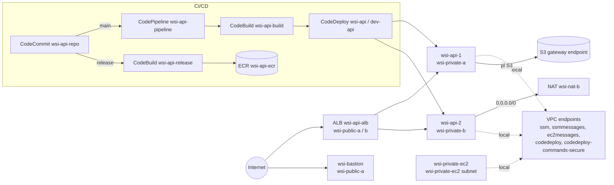

# Exemplo CI/CD

Infraestrutura de **CI/CD** de Cloud Computing na AWS, região `us-east-1`, em **CloudFormation**.

Tem o CI/CD de uma API Python/Flask (CodeCommit → CodeBuild → CodeDeploy → CodePipeline, mais ECR) e as mudanças feitas depois da prova:

- acesso às instâncias só por **SSM (Session Manager)**, sem key pair;
- subnet privada **sem NAT**, usando **VPC endpoints**;
- uma **EC2 totalmente privada**, cuja route table só tem a rota local.

## Arquitetura



## Recursos

| Recurso | Nome | Detalhes |
|---|---|---|
| VPC | `wsi-vpc` | `10.1.0.0/16`, DNS support e hostnames ligados |
| Subnets públicas | `wsi-public-a`, `wsi-public-b` | `10.1.2.0/24` (1a), `10.1.3.0/24` (1b) → `wsi-public-rt` → Internet Gateway |
| Subnet privada A | `wsi-private-a` | `10.1.0.0/24` (1a) → `wsi-private-a-rt`: rota local + endpoint do S3; sem NAT (parâmetro `PrivateANat`) |
| Subnet privada B | `wsi-private-b` | `10.1.1.0/24` (1b) → `wsi-private-b-rt`: `0.0.0.0/0` → `wsi-nat-b` |
| Subnet da EC2 privada | `wsi-private-ec2` | `10.1.4.0/24` (1a) → `wsi-private-ec2-rt`: **só a rota local** |
| NAT gateways | `wsi-nat-a`, `wsi-nat-b` | um em cada subnet pública |
| VPC endpoints (interface) | ssm, ssmmessages, ec2messages, codedeploy, codedeploy-commands-secure | private DNS, nas duas subnets privadas, SG `wsi-vpce-sg` |
| VPC endpoint (gateway) | s3 | na `wsi-private-a-rt` (yum, instalador do agente do CodeDeploy, artefatos) |
| EC2 | `wsi-bastion` | AL2023, t3.small, `wsi-public-a` (docker, git, jq) |
| EC2 | `wsi-api-1`, `wsi-api-2` | AL2, t3.small, tag `wsi:deploy:group=dev-api`, role `wsi-api`, sem key pair |
| EC2 | `wsi-private-ec2` | AL2, t3.micro, sem nada instalado; só SSM |
| ALB | `wsi-api-alb` → `wsi-api-tg` | HTTP 80, health check `GET /health` |
| CI/CD | `wsi-api-repo`, `wsi-api-build`, `wsi-api-release`, `wsi-api` / `dev-api`, `wsi-api-pipeline`, `wsi-api-ecr` | bucket de artefatos `wsi-api-artifacts-<conta>` |
| IAM | `wsi-api`, `wsi-bastion`, `wsi-codebuild-role`, `wsi-codedeploy-role`, `wsi-codepipeline-role`, `wsi-events-role` | |

### Security groups (sem `0.0.0.0/0` e sem `All` no caminho privado)

| SG | Entrada | Saída |
|---|---|---|
| `wsi-api-sg` | 80 do ALB e do bastion, 22 do bastion | 443 → `wsi-vpce-sg`, 443 → prefix list do S3 |
| `wsi-vpce-sg` | 443 de `10.1.0.0/16` | nenhuma |
| `wsi-private-ec2-sg` | nenhuma | 443 → `wsi-vpce-sg` |
| `wsi-alb-sg` | 80 de `0.0.0.0/0` (entrada pública) | 80 → `wsi-api-sg` |
| `wsi-bastion-sg` | 22 de `BastionSshCidr` | 80/443 para a internet, 22 → `wsi-api-sg` |

## Estrutura

```
infra/wsi-module-b.yaml   template CloudFormation com toda a infra
app/                      conteúdo do CodeCommit wsi-api-repo (app, buildspecs, appspec, hooks)
```

## Como subir (pelo cmd)

Pré-requisitos: AWS CLI v2 configurado (`aws configure`), git e o [Session Manager plugin](https://docs.aws.amazon.com/systems-manager/latest/userguide/session-manager-working-with-install-plugin.html) para abrir sessões. O CodeCommit só está disponível para contas que já o usavam antes de julho de 2024.

1. Criar a infra:

   ```bash
   aws cloudformation deploy --region us-east-1 --stack-name wsi-module-b --template-file infra/wsi-module-b.yaml --capabilities CAPABILITY_NAMED_IAM
   ```

   Para o enunciado original, com NAT na `wsi-private-a`, acrescente `--parameter-overrides PrivateANat=true`.

2. Enviar o código da pasta `app/` para o CodeCommit, nas branches `main` e `release`:

   ```bash
   git config --global credential.https://git-codecommit.us-east-1.amazonaws.com.helper "!aws codecommit credential-helper $@"
   git config --global credential.https://git-codecommit.us-east-1.amazonaws.com.UseHttpPath true
   git remote add codecommit https://git-codecommit.us-east-1.amazonaws.com/v1/repos/wsi-api-repo
   git subtree push --prefix app codecommit main
   git subtree push --prefix app codecommit release
   ```

   O push na `main` dispara o `wsi-api-pipeline`, que faz o deploy na `wsi-api-1` e na `wsi-api-2` e as registra no ALB. O push na `release` gera a imagem no ECR.

3. Testar:

   ```bash
   aws cloudformation describe-stacks --region us-east-1 --stack-name wsi-module-b --query "Stacks[0].Outputs" --output table
   ```

   A saída `AlbHealthUrl` deve responder `{"status":"ok"}`. As saídas `PrivateEc2Session` e `BastionSession` têm o comando `aws ssm start-session` de cada instância.

## O que mudou em relação ao enunciado

- **Sem key pair:** as instâncias da API e a EC2 privada não têm key pair nem IP público. Para entrar, use `aws ssm start-session --target <id>` com a conta do AWS CLI. O bootstrap configura o agente do CodeDeploy com `:enable_auth_policy: true`, para ele usar o endpoint `codedeploy-commands-secure`.
- **`wsi-private-a` sem NAT:** a subnet não tem rota para a internet. SSM e CodeDeploy usam VPC endpoints de interface, e o S3 usa o endpoint gateway da route table.
- **Flask no artefato:** as instâncias não alcançam o PyPI, então o CodeBuild baixa o Flask para `vendor/`, o `appspec.yml` copia para `/opt/wsi-api/vendor` e o serviço roda com `PYTHONPATH=/opt/wsi-api/vendor`.
- **Regras exatas:** os security groups do caminho privado não usam `0.0.0.0/0` nem `All`.
- **EC2 privada:** a `wsi-private-ec2` fica em uma subnet própria, com route table só com a rota local e sem nada instalado. O acesso é só por Session Manager.

Observações:

- O SG default da VPC fica com as regras padrão: o CloudFormation não altera esse SG.
- O `S3PrefixListId` padrão (`pl-63a5400a`) é o do S3 em `us-east-1`.
